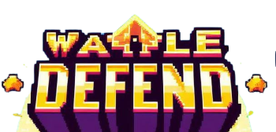

<p align="center">
  
</p>

<h1 align="center">Wallet Defend</h1>

<p align="center">
  A 2D arcade defense game built with <b>Phaser 3</b> and <b>Vite</b>.<br/>
  Defend your hard-earned savings from falling temptations and thieves!
</p>

<p align="center">
  
  
  
</p>

---

## 📖 About The Game

In **Wallet Defend**, you take control of a wallet trying to protect your money. Falling from the sky are shopping temptations and sneaky robbers out to empty your pockets! Shoot coins at temptations to earn points and stay alive, while dodging the fast-falling robbers. Catch falling piggy banks (*celengan*) to restore your life!

> *"Menabung adalah langkah awal untuk kesuksesan"* (Saving is the first step to success)

---

## 🎮 How to Play

### Controls
The game is played using on-screen interactive touch / click controls:

* ⬅️ **Left Arrow Button** (bottom-left): Move the wallet left.
* ➡️ **Right Arrow Button** (bottom-left): Move the wallet right.
* 🪙 **Shoot Button** (bottom-right): Shoot coins upward.

### Items & Enemies

| Object | Type | Behavior & Effect |
| :--- | :--- | :--- |
| 🍕 **Pizza** | Hazard / Target | Falls slowly (Speed: 75). Hit with a coin to destroy for **+10 Score**. Touching it costs **1 Life**. |
| 👜 **Shopping Bag** | Hazard / Target | Falls slowly (Speed: 75). Hit with a coin to destroy for **+5 Score**. Touching it costs **1 Life**. |
| 🦹 **Robber** | Enemy / Hazard | Falls rapidly (Speed: 300). Coins cannot destroy robbers—you must **dodge** them! Touching it costs **1 Life**. |
| 🐷 **Celengan (Piggy Bank)** | Power-Up / Life | Spawns every 20 seconds. Catch it with your wallet to **restore +1 Life** (max 3 lives). |

### Health System
* You start with **3 Lives**.
* Each collision with an obstacle decreases your life by 1.
  * **3 Lives**: Normal wallet.
  * **2 Lives**: Wallet turns red.
  * **1 Life**: Wallet turns red and semi-transparent.
  * **0 Lives**: Game Over!

---

## 🚀 Getting Started

### Prerequisites
Make sure you have [Node.js](https://nodejs.org/) (v16+ recommended) and `npm` installed.

### Installation
1. Clone the repository:
   ```bash
   git clone https://github.com/tian573/Wallet-Defend.git
   cd Wallet-Defend
   ```

2. Install dependencies:
   ```bash
   npm install
   ```

3. Start the development server:
   ```bash
   npm run start
   ```

4. Open your browser at:
   ```
   http://localhost:8000
   ```

### Production Build
To create an optimized production build:
```bash
npm run build
```
The output files will be generated in the `dist` folder.

---

## 📁 Project Structure

```text
Wallet-Defend/
├── public/
│   ├── images/       # Game sprites, buttons, title logo & backgrounds
│   └── sfx/          # Music and sound effects
├── src/
│   ├── Coin.js            # Bullet/coin projectile physics and logic
│   ├── FallingObject.js   # Base class for falling hazards and items
│   ├── GameOverScene.js   # Game over screen with score and replay
│   ├── StartScene.js      # Main menu and start button scene
│   ├── WalletDefendScene.js # Core gameplay scene and mechanics
│   └── main.js            # Phaser game configuration and entry point
├── index.html        # HTML entry point
├── package.json      # Dependencies and scripts
└── vite.config.js    # Vite configuration
```

---

## 🛠️ Built With

* [Phaser 3](https://phaser.io/) - HTML5 Game Framework
* [Vite](https://vitejs.dev/) - Frontend Tooling & Dev Server

---

## 📄 License

This project is licensed under the [MIT License](LICENSE).
